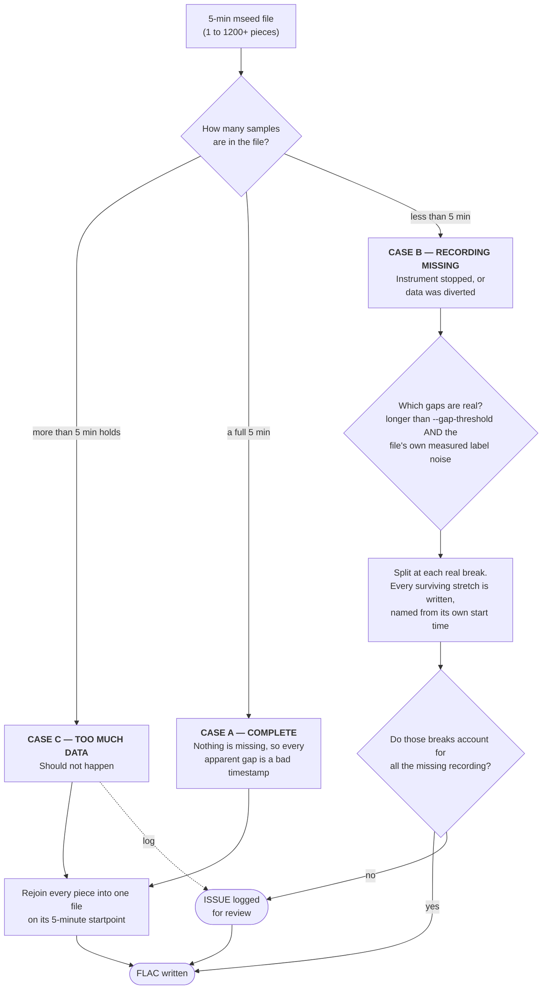

# ooi-hyd-tools

Tools for Ocean Observatories Initiative (OOI) broadband hydrophone data: repaired FLAC from
the mseed archive, calibrated hybrid millidecade spectrograms, event audio and a delayed live
stream. Adapts [pbp](https://github.com/mbari-org/pbp), [soundcoop](https://github.com/ioos/soundcoop)
and [pypam](https://github.com/lifewatch/pypam); see also [ooipy](https://github.com/Ocean-Data-Lab/ooipy)
and [hydrophone_downloader](https://github.com/bnestor/hydrophone_downloader).

| section | what it covers |
| --- | --- |
| [Install](#install) | the base install and `[pipeline]` |
| [Command-line tools](#command-line-tools) | every command, what it does, and a typical call |
| [acoustic-pipeline](#acoustic-pipeline) | stages, local mirror and server layout, run logs and checks |
| [How the repair works](#how-the-repair-works) | jitter and gap repair, file naming, bit depth |
| [What gets written](#what-gets-written) | FLAC header tags, the per-day manifest, the cal recorded in each spectrogram |
| [Live stream](#live-stream-to-orcasound) | delayed HLS of the broadband hydrophones for live.orcasound.net |
| [Hydrophone calibrations](#hydrophone-calibrations) | cal specs, where the certs come from, how one is chosen |
| [Known issues to fix](#known-issues-to-fix) | current defects, ordered by size of error on delivered products |
| [Archive coverage](#archive-coverage) | spectrogram days on S3 against days on the raw data server |
| [Broadband hydrophones](#broadband-hydrophones) | refdes, site and lat/lon |

Longer notes live in [`docs/`](docs/):

- [**24-bit-counts.md**](docs/24-bit-counts.md) - how a sample travels from pascals to counts
  to volts and back, why 24-bit counts needed a left shift, and where the +128.9 dB
  calibration offset came from.
- [**data-access.md**](docs/data-access.md) - S3 layout, how to read the FLAC, timing caveats
  and the per-day manifest. Written for external users; safe to hand out.
- [**upstream-repair.md**](docs/upstream-repair.md) - what applying the jitter and gap repair at
  ingest, in the OOI ORB driver that writes the mseed, would take.
- [**production_mseed_to_flac_conversion.md**](docs/production_mseed_to_flac_conversion.md) -
  running `mseed-to-flac` at ingest and `day-rollup` on a schedule, so FLAC and daily
  products land next to the mseed, and open questions for CI.

# Install

```
git clone https://github.com/ooi-data/ooi-hyd-tools.git
cd ooi-hyd-tools
conda create -n ooi-hyd-tools python=3.11 pip && conda activate ooi-hyd-tools
pip install -e ".[pipeline]"
```

The base install (`pip install -e .`) is obspy, numpy, soundfile and a few small libraries:
enough for
`mseed-to-flac`, `check-flac`, `event-audio`, `ooi-stream` and `ooi-listen` on local files.
`[pipeline]` adds pbp, Prefect, the netCDF stack and S3 access, which `acoustic-pipeline`,
`day-rollup` and `cal-to-nc` need.

# Command-line tools

| command | what it does | needs |
| --- | --- | --- |
| `acoustic-pipeline` | A day or range from the mseed archive: repaired FLAC, then calibrated spectrograms. Also low-frequency hydrophone and seismometer plots. Runs locally or on Prefect/ECS | `[pipeline]`; run from the repo root for cals |
| `check-flac` | Lists days in a range whose FLAC or manifest is missing or out of date; exits 1 if any | base; S3 needs `[pipeline]` |
| `mseed-to-flac` | Repairs and converts single mseed files, writing each FLAC next to its mseed. For ingest | base |
| `day-rollup` | Rolls up each day of FLAC, addenda included, into a manifest, `.nc` and `.png` next to the FLAC. Rebuilds only days whose inputs changed. For a timer | `[pipeline]` |
| `event-audio` | A time window as one repaired WAV in `./output/events`, optionally filtered and sped up for listening | base |
| `cal-to-nc` | Builds calibration netCDF from the YAML specs, and checks the committed files still match | `[pipeline]` |
| `ooi-stream` | Plays a hydrophone as Orcasound-style HLS, a fixed delay behind real time | base, ffmpeg; `--bucket` needs `[pipeline]` |
| `ooi-listen` | Plays a local `ooi-stream` with the audio's UTC and Pacific time | base, ffplay |

Typical calls; `<command> --help` lists every option.

```bash
# archive -> FLAC (./data/flac) and spectrograms (./output); run from the repo root
acoustic-pipeline --hyd-refdes CE04OSBP-LJ01C-11-HYDBBA105 --start-date 2025/02/20 --end-date 2025/03/15
#   --flag audio|spectrogram|all|low_freq|obs (default all)   --s3-sync spectrogram|all
#   --runner prefect (dispatch to ECS)   --mseed-root DIR  --flac-root DIR  --flac-layout ooi

# days in a range that need a re-run
check-flac --hyd-refdes CE02SHBP-LJ01D-11-HYDBBA106 --start-date 2016/01/01 --end-date 2026/09/30 \
    --flac-root ~/hydbb_flac --mseed-root ~/ooi/san_data

# production: each file at ingest, then each day's products on a timer
mseed-to-flac --refdes CE02SHBP-LJ01D-11-HYDBBA106 /files/CE02SHBP/LJ01D/HYDBBA106/2026/11/14/*.mseed
day-rollup --root /files --refdes CE02SHBP-LJ01D-11-HYDBBA106 --lookback-days 14

# one event for listening: the M5.5 Blanco Fracture Zone earthquake at Slope Base
event-audio --refdes RS01SLBS-LJ01A-09-HYDBBA102 --start 2026-06-29T11:35:44 --end 2026-06-29T11:42:04 \
    --bandpass 2 1000 --normalize --speed 2 --fade 1.0

# calibration specs -> netCDF
cal-to-nc template > metadata/cal_specs/{refdes}.yaml   # scaffold, fill in from the cert PDF
cal-to-nc build metadata/cal_specs/*.yaml --plot        # write the .nc plus a QA plot
cal-to-nc check metadata/cal_specs/*.yaml               # CI: committed .nc still match specs
cal-to-nc from-nc {refdes}                              # backfill a spec from existing .nc

# live stream, written locally, then played back
ooi-stream --hyd-refdes CE02SHBP-LJ01D-11-HYDBBA106 --node-name ooi_oregon_shelf --gain-db 25
ooi-listen ooi_oregon_shelf
```

- `mseed-to-flac` and `day-rollup` give the same FLAC and spectrograms as `acoustic-pipeline`
  on the same mseed. `day-rollup` reads cals from `--meta-dir` (default `./metadata`; the
  image sets `OOI_HYD_META_DIR`). Running both in production:
  [docs/production_mseed_to_flac_conversion.md](docs/production_mseed_to_flac_conversion.md).
- `event-audio`: `--bandpass LOW HIGH` isolates the event, `--speed` rewrites the sample rate so
  rumble shifts up, `--normalize` or `--gain-db` raise a quiet clip, `--fade SEC` tapers both ends.

# acoustic-pipeline

### Stages

`--flag` picks the stage. Broadband spectrograms are built from FLAC on disk, not from mseed,
so the two broadband stages can run separately:

| `--flag` | reads | writes |
| --- | --- | --- |
| `audio` | mseed archive, or a local mirror with `--mseed-root` | `FLAC_ROOT/YYYY_MM_DD/INSTRUMENT/` plus the day's manifest |
| `spectrogram` | FLAC already in `FLAC_ROOT` | `./output/INSTRUMENT_YYYYMMDD.{nc,png}` |
| `all` | same as `audio` | both, in one pass |
| `low_freq` | Earthscope, via `ooipy` | `./output/INSTRUMENT_YYYYMMDD.png` |
| `obs` | Earthscope FDSN web service | `./output/SITE/` seismometer plots |

`FLAC_ROOT` is `--flac-root`, default `./data/flac`. The spectrogram stage reads cals from
`./metadata`, so run it from the repo root. `audio` and `all` always rebuild from the archive.
To redo only a spectrogram (the usual case when pbp failed but the audio is fine), run
`--flag spectrogram`: it reuses the FLAC, never touches the raw data server, and raises
`FileNotFoundError` if the day's manifest is missing. `low_freq` and `obs` pull from
Earthscope and never read FLAC.

### Local mirror and server layout

On a machine with the raw archive mounted, `--mseed-root` reads mseed from disk instead of the
raw data server. `--flac-layout ooi` writes FLAC in the server's tree and naming, addenda in
`addendum/`, so a day can be copied in alongside its mseed; `--flac-root` picks where the tree
is built. Each works without the others.

```
acoustic-pipeline --hyd-refdes CE02SHBP-LJ01D-11-HYDBBA106 --start-date 2024/11/03 \
    --mseed-root ~/ooi/san_data --flac-layout ooi --flac-root /data/hydbb_flac --flag audio
# -> /data/hydbb_flac/CE02SHBP/LJ01D/HYDBBA106/2024/11/03/[addendum/]OO-HYEA2--YDH-<start>.flac
```

- **Mirror layout:** `ROOT/<refdes>/YYYY/MM/DD/[addendum/]`, keeping the archive's filenames,
  which end in each file's start (`YDH.` before 2016). Anything else in a day folder is
  ignored. Repaired traces are sample-identical to a remote run.
- **Missing data:** a day with no mseed is skipped. A missing `ROOT/<refdes>` raises, since an
  unmounted share would otherwise look like a run of empty days.
- **ooi layout names** carry the true start to the microsecond, so they may differ from the
  mseed's: an addendum labelled `14:45:00` whose data starts at `14:45:31.167` is named for
  14:45:31.167. The manifest sits in the day folder and lists addenda as `addendum/<name>`.
  pbp can't read these names or the split; `day-rollup` builds spectrograms from this layout.
- **Restrictions:** `--mseed-root` and `--flac-root` need `--runner local`, and `--mseed-root`
  feeds only `audio` and `all`. `--flac-layout ooi` needs `--flag audio` and is refused with
  `--s3-sync all`.

### Run logs and checks

Each run appends its log to `./logs/INSTRUMENT/INSTRUMENT_YYYYMMDD.log`, traceback included, so
reruns of a day stack up in one file; `grep -r "WARNING\|ERROR\|ISSUE" logs/` lists the days
worth a look. An mseed that won't parse (0-byte or corrupt) is skipped with an ISSUE rather
than failing the day.

A local `audio` or `all` run carries on past a failed day, then checks every day in the range
and exits nonzero listing the days to re-run. `check-flac` runs the same check on its own: a
day with mseed is flagged when it has no manifest (the run failed or was killed), when its
manifest counted a different number of mseed than are there now (late addenda), or when the
FLAC on disk, `addendum/` included, don't match the manifest. It reads only listings and
manifests. `--flac-root s3://ooi-hmb-data/flac` checks the S3 delivery; `--flac-layout ooi` a
server-layout tree.

# How the repair works

### Jitter and gap repair

The DDS mislabels when each burst of samples arrived - by anywhere from a fraction of a
millisecond to a quarter second, and the pattern differs between instruments and between
years. It never moves or duplicates recording; only the labels are wrong. So the **number
of samples**, not the timestamps, decides whether any recording is actually missing.
Timestamps are only consulted afterwards, to find where a real break happened.



What each case looks like on the clock. Every `|` is a boundary where the timestamps claim
one piece ends and the next begins - those boundaries are wrong, and the recording across
them is continuous.

```
                    0:00                                              5:00
                    |                                                    |

CASE A  COMPLETE    [==|==|==|==|==|==|==|==|==|==|==|==|==|=============]   pieces arrive mislabelled
                    [====================================================]   -> 1 file, the whole 5 min
                    19,200,000 samples = a full 5 min, so nothing is missing

CASE B  MISSING     [====|====|====|=====]          [====|====|====|=====]   a real break
                                          ^^^^^^^^^^  3 s of recording genuinely gone
                    [====================]          [====================]   -> 2 files, named from their own start
                    short by exactly 3 s, and that one break accounts for all of it

CASE C  TOO MUCH    [==|==|==|==|==|==|==|==|==|==|==|==|==|=================]
                                                                         ^^^^  more than 5 min holds
                    kept in full, but flagged for review
```

The repair discards nothing: a short file still yields audio, and missing time is reported
rather than silently dropped. A gap counts as a real break only if it is longer than
`--gap-threshold` (OEK `TrHld2`, default 0.023 s) **and** longer than the file's own measured
label noise. An overlap can't be real, since one ADC can't record an instant twice, so the
largest overlap in a file measures how far its timestamps lie (10-250 ms observed, by
instrument and era). Each file sets its own threshold, with no per-instrument or per-era
tuning. Every input comes from the file itself, so a file repaired alone (`mseed-to-flac`)
matches the same file repaired as part of a day.

### File naming and start times

Placement comes from the CI filename, not the traces: a first-trace starttime within the
file's own label noise snaps to the filename, and only a label demonstrably further off wins.
That is how a stretch following a real break gets named, and how the degenerate-timestamp case
in Known issues scatters output. Interior trace timestamps only ever locate breaks.

The default layout names files `{instrument}_{YYYYMMDD}_{HHMMSS}`, whole seconds, because that
is all pbp parses (`meta_gen/utils.py` matches `{prefix}_YYYYMMDD_HHMMSS.` and nothing after).
A recording that resumes mid-second loses up to 1 s in its name, so the exact start goes in
the file header (`date` and `comment`). The ooi layout names to the microsecond.

### FLAC bit depth

OOI mseed carries 24-bit ADC counts right-justified in int32 (the integer *is* the count,
full scale 2^23); libsndfile's int32 API is left-justified (full scale 2^31). Writing counts
straight to `PCM_24` therefore stored `count >> 8`. Since v1.7 the writer shifts left by 8
first so the true count lands in the 24-bit word. The full walkthrough, with the numbers and
where the +128.9 dB offset came from, is in [docs/24-bit-counts.md](docs/24-bit-counts.md).

# What gets written

### Audio file metadata

`write_audio` in [mseed_to_flac.py](ooi_hyd_tools/mseed_to_flac.py) sets three FLAC Vorbis
comments:

| Written as | Vorbis comment | Holds |
| --- | --- | --- |
| `date` | `DATE=` | exact start, sub-second, ISO 8601 |
| `software` | `SOFTWARE=` | `ooi-hyd-tools` + package version; libsndfile appends its own |
| `comment` | `COMMENT=` | `refdes=` `start=` `npts=` `sampling_rate=` `counts=` |

```
date=2026-08-19T00:00:00.014000Z
software=ooi-hyd-tools 1.7.0 (libsndfile-1.2.0)
comment=refdes=CE04OSBP-LJ01C-11-HYDBBA105 start=2026-08-19T00:00:00.014000Z npts=19200000 sampling_rate=64000 counts=int24_left_justified
```

Read them back with `soundfile` (`sf.SoundFile('x.flac').date`, `.comment`) or
`metaflac --list --block-type=VORBIS_COMMENT x.flac`.

### Per-day manifest

Each day's FLAC folder also gets `{instrument}_{YYYYMMDD}_manifest.json`, written after the
audio so its presence means the day finished:

```json
{
  "refdes": "CE04OSBP-LJ01C-11-HYDBBA105",
  "date": "2026-08-19",
  "written_by": "ooi-hyd-tools 1.8.2",
  "counts": "int24_left_justified",
  "sampling_rates": [64000],
  "gap_threshold_s": 0.023,
  "source_mseed_files": 288,
  "files_written": 286,
  "seconds_written": 85799.844,
  "day_coverage_pct": 99.31,
  "collisions": [{"stamp": "HYDBBA105_20260819_014500.flac", "kept_s": 299.84,
                  "dropped_s": 0.06, "dropped_start": "2026-08-19T01:45:00.098000Z"}],
  "files": [{"name": "HYDBBA105_20260819_000000.flac",
             "start": "2026-08-19T00:00:00.014000Z", "npts": 19200000, "sampling_rate": 64000}]
}
```

- `files` carries the sub-second starts that filenames round away: one read instead of 288
  headers.
- `sampling_rates` lists every rate in the day; a few days mix rates, so each file has its own.
- `day_coverage_pct` separates a short recording day from a failed upload.
- `collisions` records pieces dropped because two started in the same second (see Known
  issues). That audio is unique and is written nowhere else.
- `day-rollup` writes the same fields from the FLAC on disk, with `gap_threshold_s` null,
  plus `generated`, `fingerprint` (what the products were built from) and `products` (the
  `.nc` and `.png` names, or the error). Its `collisions` are pieces the spectrogram left out.

### Spectrogram calibration attributes

Each spectrogram `.nc` records the cal it was built with as global attributes, read from the
cal file `find_cal_file` selected, so a later change to the deployment lookup or a cal file is
visible after the fact:

| attribute | holds |
| --- | --- |
| `calibration_file` | the cal file applied, e.g. `CE04OSBP-LJ01C-11-HYDBBA105_12.nc`; `none` with `--apply-cals false` |
| `calibration_deployment` | the deployment that cal belongs to |
| `calibration_asset_id` | the hydrophone asset |
| `calibration_date` | date of the vendor cert |
| `calibration_source_pdf` | the cert PDF the values were transcribed from |
| `calibration_placeholder` | present only for a stand-in cal, with the reason (see Known issues) |
| `calibration_lf_sensitivity` | the cert's 26 Hz value, which anchors the modelled band below the cert table |
| `calibration_lf_corner_hz` | the roll-off corner of that model |

`instrument` is set from the cal file's model (`icListen model SB2-ETH` or `SB35-ETH`); with
`--apply-cals false` it keeps the static `icListen`. Products made before October 2026 carry
none of these attributes, and their `instrument` says SB35-ETH regardless of deployment.

# Live stream to Orcasound

`ooi-stream` writes [orcanode](https://github.com/orcasound/orcanode)-style HLS: 10 s AAC
segments under `<node_name>/hls/<epoch>/`, plus `latest.txt`.

- **Delay:** plays `--delay-minutes` (default 6 h) behind real time so the mseed has reached the
  raw data server. A file still missing when its turn comes streams as silence; late addendum
  data can't be added back into a live stream.
- **Repair:** each 5-min file is repaired as in the pipeline and laid on a silent buffer, so
  gaps stay gaps.
- **Epoch:** the data time of the first slot, not wall time, so an archive built from it dates
  the audio correctly.
- **Levels:** counts with a fixed `--gain-db` and a soft limiter, for listening, not calibrated
  pressure. Instruments differ by ~25 dB, so set the gain per hydrophone.
- **Output:** `--bucket s3://audio-orcasound-net` uploads as orcanode does, with Orcasound's AWS
  keys; without it, files stay in `./data/stream` for `ooi-listen`. `--start YYYY-MM-DDTHH:MM
  --mseed-root DIR` replays past data at real-time pace, for testing.

`stream/` holds a slim image (no pbp or Prefect) and a compose file running four hydrophones:
`docker compose -f stream/docker-compose.yml up -d`, with the keys in `stream/.env`.

# Hydrophone calibrations

Cal files are netCDF in `metadata/cals`, one per instrument per deployment
(`{refdes}_{deployment}.nc`), holding the manufacturer values in dB re 1 V/uPa. pbp reads
`sensitivity`: the 0/90 average for directional cals, with `sensitivity_0`/`sensitivity_90`
kept as the record. Volts-to-counts happens in code: pbp reads the 24-bit FLAC normalized to
full scale and `audio_to_spec.py` sets `VOLTAGE_MULTIPLIER = 3` (the ADC's 3 V full scale), so
sheet values apply unmodified. This retired the `rca_correction_cals` copies with a baked-in
+128.9 dB offset ([docs/24-bit-counts.md](docs/24-bit-counts.md)).

The seafloor instruments (HYDBBA102, 105, 106, 302) have cals from deployment 1; of the
mooring-mounted ones, HYDBBA303 from deployment 10 and HYDBBA103 from deployment 12.

### Calibration yamls are the source of truth

One YAML spec per instrument in `metadata/cal_specs/` holds every deployment, transcribed by
hand from the cert PDF. Edit a spec, then rerun `cal-to-nc build`; CI runs `cal-to-nc check`
(see [Command-line tools](#command-line-tools)).

- Each deployment block holds a single `sens` curve or directional `sens0`/`sens90`, in kHz
  (or `freq_units: Hz`), **copied exactly as printed** - no 0 Hz entry.
- `lf_sens` is the cert's "Sensitivity @ 26 Hz", printed beside the table. `build` uses it to
  model the band below the table: a first-order high-pass at `lf_corner_hz` (default 10 Hz)
  through the 26 Hz value, blended into the first table point and sampled densely enough for
  pbp's interpolation to follow. Without it the band is a flat copy of the first table point,
  and `build` says so.
- Validation rejects length mismatches, non-ascending frequencies and values outside -220 to
  -120 dB; `build` warns when mean sensitivity jumps more than 6 dB between deployments.
- `notebooks/11_calibration_curve_plot.ipynb` plots every curve as pbp applies it;
  `plot_cal(refdes, dep, preview_lf_sens=...)` previews a value before it goes in a spec.

### Where the PDFs come from

[calibrationFiles/HYDBBA](https://github.com/OOI-CabledArray/calibrationFiles/tree/master/HYDBBA),
named `{asset_id}__{YYYYMMDD}.pdf` to match each spec's `asset_id` and `cal_date`;
`OOI-CabledArray/deployments` (`HYDBBA_deployments.csv`) maps each deployment to its cert. Many
are scans that GitHub's viewer shows blank - download one before concluding it holds no
calibration.

### How a cal file is selected

`find_cal_file()` in [audio_to_spec.py](ooi_hyd_tools/audio_to_spec.py) reads the deployment
table live from OOI asset management (`deployment/{node}_Deploy.csv`, `{node}` = first 8
characters of the refdes). pbp applies one sensitivity per day, so the day takes the cal of the
deployment covering most of it, with a warning on turnover days. A day with no deployment, or a
missing cal file, raises rather than producing uncalibrated output; `--apply-cals false` skips
calibration. Built cal files record `source_spec`, `source_pdf`, the `lf_*` values, and
`placeholder` for stand-ins, which `find_cal_file` also logs at run time.

# Known issues to fix

Missing products first, then ordered by size of the error on delivered spectrograms.

| issue | where | detail |
|---|---|---|
| Not processed | all instruments; 2015-2017 entirely | **Most of the archive has no spectrogram**: 12-76% of raw days by instrument (see [Archive coverage](#archive-coverage)). 2015-2017 has only spot-check days, and 105 and 106 are thin in most years. 103 and 303 before 2025 also need cals (No cal, below) |
| Reprocess | `HYDBBA302` 2016-07-12 to 2017-07-31 | Dep 3 was calibrated with a 2018 sheet postdating a hardware rebuild. Cal now correct; products from that window are **-4.68 dB off on average, up to 8.65 dB at 190.7 kHz** |
| Suspect cert | `HYDBBA106` deps 1 and 3 (2014-2015, 2016-2017) | The 2013 cert `ATOSU-58324-00014__20130802` tabulates -175.1 dB at 13.5 kHz, **3-5 dB below every later cert for that hydrophone**, though its 26 Hz value matches them. Transcribed correctly, so either the cert is wrong or the unit changed. Products above 13.5 kHz are suspect by several dB |
| Reprocess | `HYDBBA102` 2016-07-17 to 2017-07-29 | Dep 3 was calibrated with dep 2's hydrophone. Cal now correct; products from that window are **-2.10 dB off on average, up to 5.40 dB at 90.4 kHz** |
| Modeled | all instruments, below 10 kHz | Certs tabulate from 10 kHz (13.5 kHz on four early deployments); below that the cal is a first-order roll-off through the cert's 26 Hz value, 10 Hz corner, **within ~1.5 dB at 10 Hz**. Products without `calibration_lf_*` attributes predate the model (2026-10-06) and use a flat copy of the first table point |
| Untracked | all instruments | Sheets bake a **preamp gain** into the sensitivity (36 dB on most, 30 dB on `ATAPL-58324-00005__20131211`) but specs don't record it, so a mismatched preamp would go unnoticed |
| Step change | all instruments, >12 kHz | The v1.7 bit-depth fix removed **+0.96 dB at 20-27 kHz** (+0.45 at 12-20 kHz). Within daily variability, but a step in multi-year records; note reprocess dates for trend work |
| Placeholder | `HYDBBA105` deps 2, 4 and 10 | **True vendor cals missing.** Dep 10's doc is a pressure-test certificate, so it uses the prior cal; deps 2 and 4 have only plot-only certs before them, so they use the next later cal. Each carries a `placeholder` reason |
| No cal | `HYDBBA303` deps 1-9 (2014-2024), `HYDBBA103` deps 1-11 (2014-2025) | Not transcribed, so spectrograms raise `FileNotFoundError` for about ten years of each. Certs exist in calibrationFiles. **Deprioritised**: both are mooring-mounted |
| Collision loss | seafloor instruments; `HYDBBA106` 419 of 1,902 days | Two pieces starting in the same second can't both get a whole-second name; the guard keeps the longer and logs an ISSUE. The dropped piece is **unique audio**: ~1.4 h across `HYDBBA106`'s archive, but **about a third of the day** on days CI split into ~1,600 files (2019-12-08, 2022-11-29). `--flac-layout ooi` and `mseed-to-flac` name files to the microsecond and keep both; the pbp layout, and so every spectrogram, still drops one |
| Mixed rates | `HYDBBA106` 2024-08-20 (6.4 kHz addenda), 2025-06-24 to 06-28 (64/128/256 kHz) | FLAC headers and manifests (from v1.8.2) carry each file's rate. Whether pbp handles mixed rates within a day is **unchecked**, so treat those days' spectrograms as suspect |
| Junk stub files | seafloor instruments | Stubs straddling a file boundary round to their own second and survive as 64-sample FLACs - **152** on `HYDBBA102`'s 622-file 2016-07-20, **366** across `HYDBBA106`'s archive. Acoustically harmless; a minimum-duration floor would drop them |
| Duplicated packets | `HYDBBA105`, `HYDBBA302` 2023-06-15 17:25-17:35; extent unknown | CASE C (more samples than 5 min holds) on both instruments in the same three windows with matching sizes, pointing to duplicated packets shore-side. Audio is kept and flagged, so six FLACs run slightly over 300 s: **suspect for sample-accurate work**. `HYDBBA106`'s full archive has one (2026-10-25); the other instruments have **not been swept** |
| Degenerate timestamps | `HYDBBA102` 2023-06-15; extent unknown | Every trace in a file shares one timestamp, so naming from the first trace **scatters output and fragments the spectrogram**; the audio itself is correct. Upstream only began per-trace starttimes in Sep-Oct 2023, so earlier data may be affected. Fix (name from the filename when labels span less time than the audio) not implemented; **not surveyed** |

The two Reprocess windows hold one delivered day each so far (2016-07-20 and 2017-03-20);
backfilling them with the current cals clears both rows.

# Archive coverage

Spectrogram days in `s3://ooi-hmb-data/hmb/` against day folders on the raw data server, as of
2026-11-25. A raw day folder can hold a partial day, so 100% isn't expected.

| year | 106 | 105 | 102 | 103 | 302 | 303 |
| --- | ---: | ---: | ---: | ---: | ---: | ---: |
| 2015 | 0 / 41 | 0 / 41 | 0 / 41 | 0 / 41 | 0 / 34 | 0 / 37 |
| 2016 | 1 / 282 | 1 / 307 | 1 / 309 | 0 / 323 | 1 / 309 | 0 / 284 |
| 2017 | 1 / 342 | 1 / 267 | 1 / 323 | 0 / 317 | 1 / 344 | 0 / 346 |
| 2018 | 48 / 198 | 40 / 275 | 310 / 315 | 0 / 127 | 321 / 325 | 0 / 180 |
| 2019 | 165 / 207 | 68 / 69 | 339 / 340 | 0 / 148 | 340 / 340 | 0 / 37 |
| 2020 | 0 / 8 | - | 216 / 222 | 0 / 91 | 122 / 222 | 0 / 222 |
| 2021 | 67 / 67 | 118 / 119 | 316 / 323 | 0 / 322 | 329 / 332 | 0 / 333 |
| 2022 | 12 / 23 | 317 / 318 | 300 / 318 | 0 / 306 | 285 / 285 | 0 / 310 |
| 2023 | 0 / 131 | 1 / 300 | 121 / 330 | 0 / 333 | 332 / 332 | 0 / 332 |
| 2024 | 32 / 355 | 32 / 352 | 355 / 358 | 0 / 340 | 355 / 358 | 0 / 358 |
| 2025 | 157 / 353 | 68 / 269 | 333 / 361 | 111 / 356 | 334 / 362 | 113 / 359 |
| 2026 | 283 / 327 | 129 / 153 | 288 / 327 | 283 / 327 | 286 / 327 | 285 / 327 |
| all | **33%** | **31%** | **72%** | **13%** | **76%** | **13%** |

`check-flac --flac-root s3://ooi-hmb-data/flac` lists days with mseed but no FLAC on S3. A day
can have FLAC but no `.nc` (pbp failed), so compare `hmb/` listings too.
`acoustic-pipeline --runner prefect --s3-sync all` fills both.

# Broadband hydrophones

| refdes | site | lat, lon (approx.) |
| --- | --- | --- |
| CE02SHBP-LJ01D-11-HYDBBA106 | Oregon Shelf | 44.63721, -124.30564 |
| CE04OSBP-LJ01C-11-HYDBBA105 | Oregon Offshore | 44.36933, -124.95347 |
| RS01SLBS-LJ01A-09-HYDBBA102 | Slope Base Seafloor | 44.51505, -125.39002 |
| RS01SBPS-PC01A-08-HYDBBA103 | Slope Base Platform | 44.51516, -125.38990 |
| RS03AXBS-LJ03A-09-HYDBBA302 | Axial Base Seafloor | 45.81676, -129.75426 |
| RS03AXPS-PC03A-08-HYDBBA303 | Axial Base Platform | 45.81671, -129.75405 |

The code reads these, and the low-frequency hydrophones `low_freq` plots, from
[instruments.py](ooi_hyd_tools/instruments.py). Interactive map of assets at
https://app.interactiveoceans.washington.edu/map
